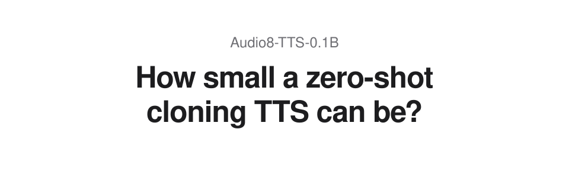

<div align="center">


<h1 align="center">Audio8 TTS</h1>

**Compact text-to-speech models for zero-shot voice cloning.**

[](https://github.com/Edge0-AI/Audio8_TTS)
[](LICENSE)

[English](README.md) · [中文](README_zh.md)

[0.6B family](#family-06b) · [0.1B family](#family-01b)

</div>

## Releases

<a id="family-06b"></a>

<details open>
<summary><strong>0.6B family</strong></summary>

<div align="center">


[](https://huggingface.co/Edge0/Audio8-TTS-Realistic-0.6b)
[](https://edge0-ai.github.io/Audio8_TTS/realistic-0.6b/)
[](https://arxiv.org/abs/2610.14776)

</div>

**Audio8-TTS-Realistic-0.6B** builds on Preview with substantially improved speech realism, retaining the same compact 0.6B architecture and zero-shot voice cloning. It supports **23 languages**, adding **12 languages compared with Preview**.

Audio8 is also participating in [TTS Arena](https://tts-agi-tts-arena-v2.hf.space/), where it has received encouraging ratings from listeners. We are grateful to everyone who has listened and voted.

| Release | Focus and languages | Model | Listen | Guide |
|---|---|---|---|---|
| **Realistic 0.6B** | Realism and prosody · 23 languages | [HF](https://huggingface.co/Edge0/Audio8-TTS-Realistic-0.6b) | [Demo](https://edge0-ai.github.io/Audio8_TTS/realistic-0.6b/) | [Details](guides/models/realistic-0.6b.md) |

**ONNX:** There is currently no Realistic ONNX export.

<details>
<summary><strong>0.6B details: languages, quick start, and evaluation</strong></summary>

#### Realistic 0.6B language support

| Coverage | Languages |
|---|---|
| 11 languages supported in Preview | Cantonese, Chinese, Dutch, English, French, German, Italian, Japanese, Korean, Polish, Spanish |
| 12 additions in Realistic | Arabic, Finnish, Hindi, Indonesian, Malay, Norwegian, Portuguese, Russian, Swedish, Thai, Turkish, Vietnamese |

> **Note:** Quality varies by language; benchmark coverage differs from the supported-language list. [Per-language results](guides/models/realistic-0.6b.md#multilingual-detail).

#### Realistic 0.6B quick start

Use Python 3.10+ and a CUDA-capable GPU. Run from the repository root. The explicit model ID selects Realistic independently of the scripts' existing Preview default.

```bash
git clone https://github.com/Edge0-AI/Audio8_TTS.git
cd Audio8_TTS
python3 -m venv .venv
source .venv/bin/activate
pip install -r requirements.txt

python audio8_tts_infer.py \
  --model Edge0/Audio8-TTS-Realistic-0.6b \
  --text "Welcome to Audio8 TTS. It is wonderful to hear from you." \
  --output outputs/realistic.wav
```

For voice cloning, add `--reference-audio reference.wav --reference-text "The exact transcript of the recording."`.

[Installation, cloning and batch inference](guides/inference.md) · [Supervised fine-tuning](guides/training.md)

#### 0.6B evaluation summary

Error rates are percentages (lower is better). SIM uses a 0–1 scale (higher is better). Neither directly measures speech realism.

**Audio8-TTS-Preview** and **Audio8-TTS-Realistic**, both **0.6B**:

| Benchmark | Coverage | Preview error % ↓ | Realistic error % ↓ | Preview SIM ↑ | Realistic SIM ↑ |
|---|---|---:|---:|---:|---:|
| Seed-TTS | English / Chinese | 1.23 | 1.25 | 0.682 | 0.704 |
| CV3 | 8 shared languages | 4.80 | 4.56 | — | 0.663 |
| CV3 | 9 core languages | — | 4.86 | — | 0.661 |
| MiniMax | 24 evaluated languages | — | 5.89 | — | 0.754 |

> **Note:** Values are unweighted language macro averages. Preview results are calculated from its [published model card](https://huggingface.co/Edge0/Audio8-TTS-Preview-0.6b#evaluation), with SIM converted from percentages to a 0–1 scale. The two releases were evaluated separately. A dash means the corresponding result was not reported on Preview's card.
>
> Seed-TTS averages English WER and Chinese CER, excluding hard Chinese. The shared CV3 subset is Chinese, English, Japanese, Korean, German, French, Spanish, and Italian; the 9-language set also includes Russian. CV3 averages exclude hard subsets and the 13 additional languages. MiniMax averages all 24 evaluated languages, including languages outside the supported list.

[Full Realistic evaluation and comparison notes](guides/models/realistic-0.6b.md#evaluation) · [Original Preview evaluation](guides/models/preview-0.6b.md#evaluation)

</details>

<details>
<summary><strong>Previous release · Preview 0.6B</strong></summary>

Realistic builds on Preview. The original checkpoint, **11-language** coverage, evaluation, and listening page remain available for Preview users.

| Release | Model | Listen | Guide | Deployment |
|---|---|---|---|---|
| Preview 0.6B | [HF](https://huggingface.co/Edge0/Audio8-TTS-Preview-0.6b) | [Demo](https://edge0-ai.github.io/Audio8_TTS/preview-0.6b/) | [Details](guides/models/preview-0.6b.md) | [ONNX INT4](onnx_runtime/README.md) |

</details>

</details>

---

<a id="family-01b"></a>

<details open>
<summary><strong>0.1B family</strong></summary>

<div align="center">



[](https://huggingface.co/Edge0/Audio8-TTS-Preview-0.1b)
[](https://huggingface.co/Edge0/audio8-TTS-0.1B-ONNX-INT8)
[](https://edge0-ai.github.io/Audio8_TTS/0.1B/)

</div>

Meet **Audio8-TTS-0.1B**: a compact, portable text-to-speech model with zero-shot voice cloning.

Designed for a smaller deployment footprint, with **Chinese and English as its primary languages**. The dedicated ONNX INT8 runtime supports CPU inference, streaming, and local web/HTTP serving.

| Release | Focus and languages | Model | Listen | Guide |
|---|---|---|---|---|
| Preview 0.1B | Compact hybrid · primarily Chinese / English | [HF](https://huggingface.co/Edge0/Audio8-TTS-Preview-0.1b) | [Demo](https://edge0-ai.github.io/Audio8_TTS/0.1B/) | [Details](guides/models/preview-0.1b.md) |

[0.1B quick start](guides/models/preview-0.1b.md#inference) · [CPU / ONNX runtime](onnx_runtime_0_1b_int8/README.md) · [0.1B deployment](guides/models/preview-0.1b.md#deployment) · [Model license](guides/models/preview-0.1b.md#license)

</details>

---

## Shared tools

[Installation and inference](guides/inference.md) · [Supervised fine-tuning](guides/training.md)

The shared tools accept an explicit model ID. Use the quick-start and deployment instructions for your chosen release.

## SGLang Omni Serving

SGLang Omni provides paged attention, dynamic batching, and an OpenAI-compatible speech API. The 0.6B family and the 0.1B hybrid model have their own configurations. Existing performance results remain paired with their original model, hardware, and test conditions in the deployment guide.

[Deployment matrix, installation and server configuration](guides/deployment.md) · [API, streaming and troubleshooting](guides/deployment.md#sglang-omni-serving)

## License and acknowledgements

The repository code and both 0.6B releases use [Apache License 2.0](LICENSE). The 0.1B checkpoint has its own [model license](https://huggingface.co/Edge0/Audio8-TTS-Preview-0.1b#license); consult the license packaged with each model/export. See [NOTICE](NOTICE) for attribution. We thank the Fish Audio team for the DualAR architecture used in Fish Audio S2 Pro.
